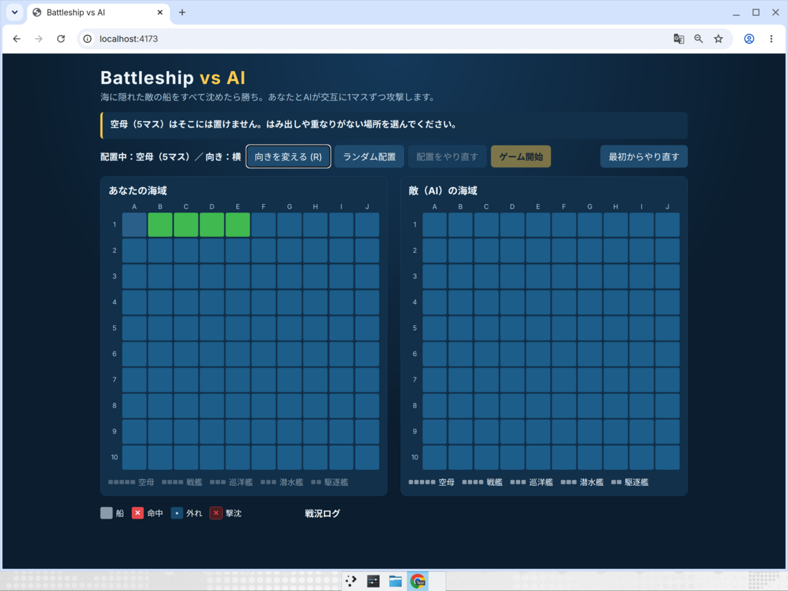
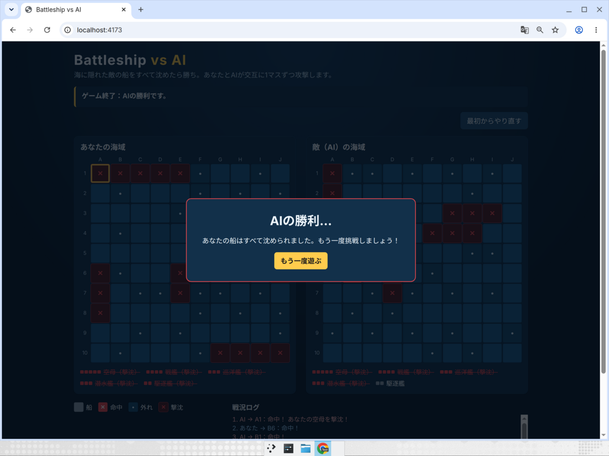
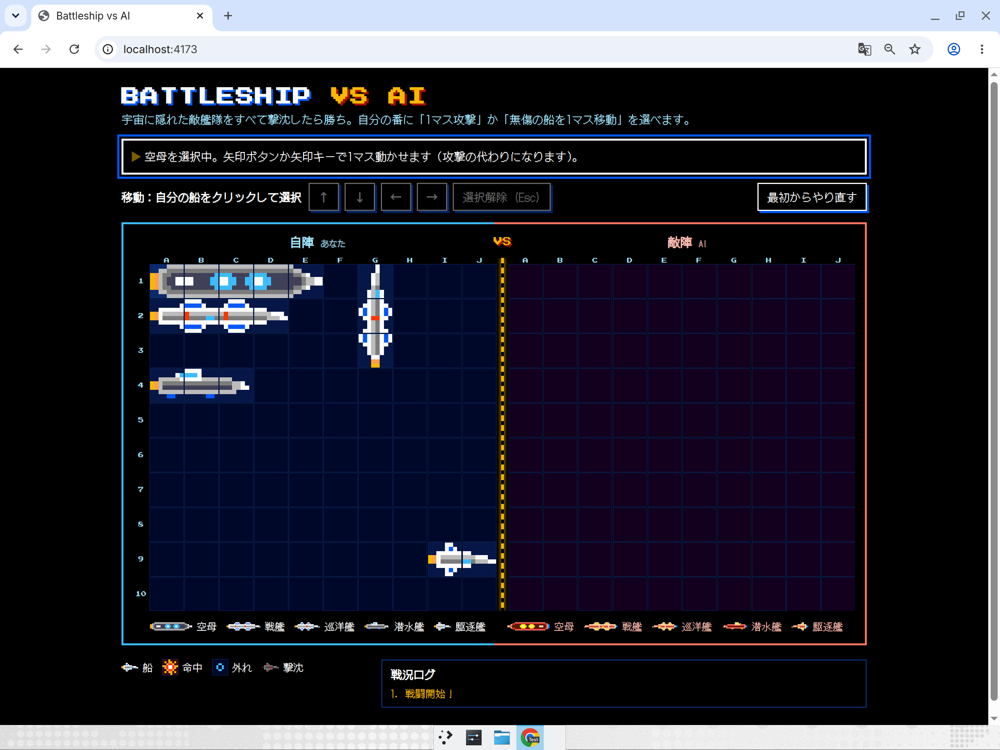
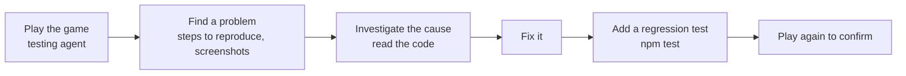

# Bug Report: Bugs Found and How They Were Fixed

[日本語版はこちら](bug-report.md)

After the game was finished, we played it many times in a real browser to check how it behaves (Devin's testing agent drove the screen).
This page lists each problem we found, its cause, and how it was fixed.

## What we checked (checklist)

| Check | Result |
| --- | --- |
| Can the game start normally? (the start button stays disabled until all 5 ships are placed) | OK |
| Can ships be placed correctly? (rotate, reject off-board / overlapping ships, undo, random placement) | OK (1 display bug → **Bug 1**) |
| Does the AI attack normally? (it fires automatically about 0.7 s after the player) | OK |
| Does the AI avoid firing at the same cell again? (45 shots in one game, all at different cells) | OK (1 visual bug → **Bug 7**) |
| Are hits and misses judged correctly? (✕ / •, message, log, sunk display) | OK |
| Does the game end when all ships are sunk? (both win and loss) | OK (1 end-screen bug → **Bug 2**) |
| Does restart work? (during a battle, while waiting for the AI, after the game ends) | OK |
| Does rapid clicking during the AI's turn avoid double attacks? Are clicks on already-attacked cells ignored? | OK |
| Is the game playable at phone width (400 px)? | OK |

## Bugs found

### Bug 1: In the placement preview, only the cell under the mouse does not change colour (severity: low)

**Symptom**
Before you place a ship, hovering shows a preview: green where it can be placed, orange where it cannot.
But **only the cell directly under the mouse stayed blue**, so the 5-cell carrier looked like 4 cells.



**Cause**
A CSS priority (specificity) problem. The rule for every button, `button:hover:not(:disabled)` ("make it a slightly lighter blue on hover"),
was **stronger (more specific)** than the preview rule `.cell.preview-ok`, so the cell under the mouse was painted blue.

**Fix**
The generic hover colour is no longer applied to grid cells (`src/style.css`).

```diff
- button:hover:not(:disabled) { background: #2a5f8a; }
+ button:not(.cell):hover:not(:disabled) { background: #2a5f8a; }
```

### Bug 2: The game-over screen covers the board and cannot be closed (severity: medium)

**Symptom**
When you lose, the board is supposed to reveal where the enemy ships were.
But the result screen ("AIの勝利…") sat on top of the board with no close button, so **the remaining enemy ships (for example the destroyer at B6–B7) could not be seen**.
Pressing "もう一度遊ぶ" (play again) resets the board, so there was no way to look at the final position.



**Cause**
The result screen was always shown once the game ended, and there was no way for the player to close it.

**Fix** (`src/ui/app.ts`)
- Added a **"盤面を確認する" (view the board) button** to the result screen. It closes the screen so you can see the final board, including the revealed enemy ships.
- After closing it, the top message still shows who won, and "最初からやり直す" (start over) begins the next game.
- The "closed" state is reset on restart.

```ts
let resultDismissed = false;               // whether the result screen was closed
els.viewBoards.addEventListener('click', () => { resultDismissed = true; render(); });
els.result.hidden = !over || resultDismissed;
```

**Regression test** (`tests/app.test.ts`)
Added "after a loss, the result screen can be closed to see the revealed remaining enemy ships".
It plays until the AI wins, presses "盤面を確認する", and checks that every enemy ship cell is shown and that a restart works.

## Extra check: the single-board version (left = your zone, right = enemy zone)

After merging the two boards into one split by a centre line, the testing agent played 3 full games (manual placement → loss, random placement → win, random placement → loss).

| Check | Result |
| --- | --- |
| Ships can be placed only in the left half (your zone); hovering the right half shows no placement colour | OK |
| Clicking the right half (enemy zone) attacks, and hit / miss / sunk are shown correctly | OK |
| The AI never fires at the same cell twice (41, 36 and 64 shots in 3 games, all different cells) | OK |
| One-cell ship moves (buttons and arrow keys); moving off the board, onto another ship or onto a shot cell is refused | OK (1 display bug → **Bug 3**) |
| The game ends when all ships are sunk and shows the result; "盤面を確認する" and "もう一度遊ぶ" work | OK |
| Restarting while waiting for the AI does not let the old game's AI attack | OK |
| Column (A–J) and row (1–10) labels line up with the cells; the centre line is in the middle | OK |
| At phone width (390 px) the board can be scrolled sideways and played | OK |

### Bug 3: After cancelling the ship selection with Esc, the "selected" hint stays (severity: low)

**Symptom**
During a battle, clicking your own ship shows "空母を選択中。矢印ボタンか矢印キーで1マス動かせます" (carrier selected; move it one cell with the arrow buttons or keys) at the top.
Pressing Esc removed the selection frame and the move buttons, but **the hint at the top still said "selected"**.
(The ship never moved by itself; it was only a display problem.)



**Cause**
There were two places that cancelled the selection. The "選択解除" (deselect) button reset the hint, but **the Esc key handler forgot to**.

**Fix** (`src/ui/app.ts`)
Both now call one function, `deselect()`.

```ts
function deselect() {
  selected = null;
  status = 'あなたの番です。敵陣（右側）をクリックして攻撃するか、自分の船を選んで1マス動かしましょう。';
  render();
}
els.moveCancel.addEventListener('click', deselect);            // deselect button
if (e.key === 'Escape' && selected) deselect();                // Esc key
```

**Regression test** (`tests/app.test.ts`)
Added "deselecting with Esc also returns the top hint to the normal turn hint" (47 tests in total at that time).

### Bug 4: If the AI scores the first hit, the browser may block the sound effect (severity: low)

Found by the automatic review (Devin Review) while sound effects were being added, and fixed before release.

**Symptom**
The sound device (`AudioContext`) was created the first time a sound played.
If you kept missing or moving ships and **the AI hit first**, that sound played inside the AI's timer (`setTimeout`).
Some browsers (especially Safari) only allow sound during a click or key press, so no sound came out.

**Cause**
The sound device was created "when a sound first plays" instead of "at the moment of a click".

**Fix** (`src/ui/sound.ts` / `src/ui/app.ts`)
Added `unlock()` to `SoundPlayer`. It is called on every click and key press anywhere on the page, and creates the device then (or resumes it if suspended).

```ts
root.addEventListener('click', () => sound.unlock());   // on every click
const onKeydown = (e) => { sound.unlock(); /* … */ };    // on every key press
```

**Regression tests**
- `tests/sound.test.ts`: "unlock() creates the AudioContext during a click and resumes it if suspended (does nothing while muted)"
- `tests/app.test.ts`: "prepares sound on every click and key press"

### Bug 5: Winning with the last shot shows "victory" before the missile lands (severity: low)

Found by the automatic review (Devin Review) after combining three features (sound, AI strength, missiles), and fixed before release.

**Symptom**
When you fired the winning shot, the top bar changed to "ゲーム終了：あなたの勝利です！" (game over: you win) and the remaining enemy ships were revealed while the missile was still flying. Sound and the battle log waited for the impact, so things appeared out of order. The same happened when the AI fired the last shot.

**Cause**
The rules decide the winner the moment a shot is fired (`game.phase` becomes `over`). `renderResult()` only checked "is the game over?", so it showed the result right after launch.

**Fix** (`src/ui/app.ts`)
While a missile is flying, `awaitingImpact` is `true`, and the result screen, message and enemy-ship reveal wait. It goes back to `false` on impact (or immediately when missiles are not animated).

```ts
const over = game.phase === 'over' && !awaitingImpact;
```

**Regression test**
- `tests/missile.test.ts`: "even when the last shot wins, the result is shown only after the missile lands"

### Bug 6: The win/loss record is lost with another tab open or where storage is unavailable (severity: low)

**How it was found**: the automatic review (Devin Review) of the PR that added the win/loss record

**Symptom**
- With the game open in two tabs, a win in one tab was overwritten and lost by a loss in the other.
- Where the browser cannot save (storage full or blocked), counting the next game's result erased the previous one.

**Cause**
Adding a result used only the count the current tab remembered,
and after a failed save it re-read the old count from storage.

**Fix**
`add` in `src/ui/record.ts` now re-reads the latest count from storage just before adding (so other tabs' results are kept).
If storage is missing, unreadable, or the last save failed, it uses the count the tab remembers.

**Regression tests**
- `tests/record.test.ts`: "does not overwrite a record saved by another tab", "keeps counting in the page where storage is unavailable", "keeps the in-page record when reading or writing throws"

### Bug 7: You could act while the AI missile was flying, so it looked as if the AI fired at an already-attacked cell (severity: medium)

**How it was found**: a report from the user who played the public game ("すでに打ち込んだ場所にAIが何度も攻撃していた" — the AI kept attacking cells it had already hit)

**Symptom**
During the ~0.8 s while the AI missile flew toward your zone, you could already attack again or select a ship.
Clicking right away made your missile and the AI missile fly over your zone at the same time, and the top message changed midway.
So it looked as if the AI fired again at a marked cell.
(The AI never actually fires at the same cell twice: in 180 automated games there were 0 repeats.)

**Cause**
By the rules, your turn starts the moment the AI fires.
The screen (`src/ui/app.ts`) only checked "is it your turn?", not "has the missile landed?".

**Fix**
Added `playerCanAct()` to `src/ui/app.ts`. You can attack, select or move a ship only on your turn and when no missile is in the air.
While a missile is flying, the enemy cells and move buttons are shown as disabled.

**Regression test**
- `tests/app.test.ts`: "while the AI missile is flying, you can neither attack nor select a ship"

### Bug 8: When a ship erases a miss mark, the attack count and hit rate on the result screen are wrong (severity: low)

**How it was found**: the automatic review (Devin Review) of the PR that changed the ship-movement rules

**Symptom**
Under the new rules, the miss mark on a cell where a ship stops is erased. The result screen counted the marks left on the board,
so erased misses and "no effect" attacks were not counted: the attack count was too low and the hit rate too high.

**Cause**
The attack record relied only on the marks on the board, and marks can be erased when ships move.

**Fix**
`Game` in `src/game/game.ts` now keeps `shots` (number of attacks and hits) and counts every attack in `resolveRound`. The result screen shows these numbers.

**Regression test**
- `tests/game.test.ts`: "attacks and hits are counted correctly even when a ship erases a miss mark"

### Bug 9: On the defence turn, clicking the selected ship itself moves it (severity: low)

**How it was found**: the automatic review (Devin Review) of the PR that changed moves to one cell

**Symptom**
After selecting a ship, clicking its middle cell again moved the ship one cell forward or back even though that cell was not highlighted, and the AI fired immediately.

**Cause**
When working out the move direction from the clicked cell, the candidates included not only the cells the ship would newly enter but also the cells it already occupied.

**Fix**
`onDefenseClick` in `src/ui/app.ts` ignores clicks on cells the selected ship currently occupies.

**Regression test**
- `tests/app.test.ts`: "on the defence turn, selecting a ship and clicking a highlighted cell moves it one cell, then the AI fires" (also checks that clicking the ship's own cells does not move it)

### Bug 10: After a ship moves, hitting an already-hit part again is not counted (severity: medium)

**How it was found**: a report from the user who played the public game ("戦艦を移動した先で、前に当たっていた場合に被弾がカウントされなかった" — after a ship moved, a hit on a part that had been hit before was not counted)

**Symptom**
When the defending ship moves, its hit marks move with it. If an already-hit part moved onto the cell the attacker targeted, the attack had "no effect" and was not counted as a hit.

**Cause**
Hits were counted per part of the ship, and a second hit on the same part was ignored.

**Fix**
Added `receiveRepeatHit` to `src/game/board.ts`, called from `resolveRound` in `src/game/game.ts`. A hit on an already-hit part counts as one more hit, and the ship sinks once its hit count equals its length.

**Regression test**
- `tests/game.test.ts`: "a hit part that moves onto the target cell still counts as one hit, and the ship sinks after as many hits as its length"

### Bug 11: The red dots in the right-hand fleet panel light up before the missile lands (severity: low)

**How it was found**: a report from the user who played the public game ("被弾する前に、右側のマルポチが点灯しています" — the dots on the right light up before the ship is hit)

**Symptom**
After an attack, the red dots, "被弾 n/length" (hits n/length) and the "被弾／撃沈" (damaged / sunk) badge in the right-hand fleet panel changed while the missile was still flying.

**Cause**
The rules finish judging the hit when the shot is fired. The board marks were hidden until impact, but the fleet panel showed the already-judged count right away.

**Fix**
In `src/ui/app.ts`, the struck ship's hit state just before the attack is judged is remembered as `struckInFlight`, and `renderFleet` shows that state (red dots and hit count) until the missile lands.

**Regression test**
- `tests/missile.test.ts`: "the red dots and hit count in the fleet panel increase only after the missile lands"

## Environment problems found during development (not game bugs)

| Problem | Cause | Action |
| --- | --- | --- |
| The first test tool installed (Vitest 3) had a known vulnerability | Old version | Detected with `npm audit`; updated to the fixed Vitest 4.1.12 (0 vulnerabilities) |
| `npm install` failed with `Cannot read properties of null (reading 'edgesOut')` | A bug in npm 10.8.3 | Solved by updating to npm 11 |
| A test failed because it counted the legend (example cells) as attacked cells | The test's selector was too broad | Changed it to count only board buttons (`button.cell`) |

## Workflow (fixing bugs with Devin)


