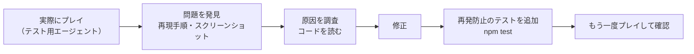

# バグレポート：発見したバグと修正内容

ゲーム完成後、ブラウザで実際に何度もプレイして動作を確認しました（Devin のテスト用エージェントが画面を操作）。
このページでは、見つかった問題・原因・修正方法をまとめます。

## 確認したこと（チェックリスト）

| チェック項目 | 結果 |
| --- | --- |
| ゲームは正常に開始できるか（5隻置くまで開始ボタンは押せない） | OK |
| 船を正しく配置できるか（回転・はみ出し/重なりの拒否・やり直し・ランダム配置） | OK（表示の不具合1件 → **バグ1**） |
| AIは正常に攻撃するか（プレイヤーの攻撃の約0.7秒後に自動で攻撃） | OK |
| AIが同じ場所を何度も攻撃しないか（1ゲーム45発がすべて異なる座標） | OK（見た目の不具合1件 → **バグ7**） |
| 命中・失敗が正しく判定されるか（✕/•、メッセージ、ログ、撃沈表示） | OK |
| すべての船が沈んだときにゲームが終了するか（勝利・敗北の両方） | OK（終了画面の不具合1件 → **バグ2**） |
| 再スタート機能が正常に動くか（対戦中・AIの攻撃待ち中・終了後） | OK |
| AIの番に連打しても二重攻撃にならないか / 攻撃済みマスを押しても無視されるか | OK |
| スマホ幅（400px）でも遊べるか | OK |

## 見つかったバグ

### バグ1：配置プレビューで、マウスを置いたマスだけ色が変わらない（重要度：低）

**症状**
船を置く前、マウスを乗せると「置ける場所＝緑」「置けない場所＝オレンジ」でプレビューされます。
ところが **マウス直下の1マスだけ青いまま** で、5マスの空母が4マスに見えていました。


**原因**
CSS（見た目のルール）の優先順位の問題です。すべてのボタンに付けていた
「マウスを乗せたら少し明るい青にする」というルール `button:hover:not(:disabled)` が、
プレビュー色のルール `.cell.preview-ok` より **強い（詳細度が高い）** ため、マウス直下のマスだけ青で上書きされていました。

**修正**
汎用のホバー色をマス目には適用しないようにしました（`src/style.css`）。

```diff
- button:hover:not(:disabled) { background: #2a5f8a; }
+ button:not(.cell):hover:not(:disabled) { background: #2a5f8a; }
```

### バグ2：ゲーム終了画面が盤面を覆い、閉じられない（重要度：中）

**症状**
負けたときは、どこに敵の船が残っていたかを盤面に表示する仕組みになっています。
しかし結果画面（「AIの勝利…」）が盤面の上に重なり、閉じるボタンもないため、**残っていた敵の船（例：B6〜B7 の駆逐艦）が見えません**。
「もう一度遊ぶ」を押すと盤面がリセットされるので、最後の状況を確認する方法がありませんでした。


**原因**
結果画面を「ゲームが終わったら必ず表示する」作りにしていて、利用者が閉じる手段を用意していなかったためです。

**修正**（`src/ui/app.ts`）
- 結果画面に **「盤面を確認する」ボタン** を追加。押すと結果画面が閉じ、最終盤面（公開された敵の船を含む）を確認できます。
- 閉じた後も上部のメッセージに勝敗を表示し、「最初からやり直す」ボタンで次のゲームを始められます。
- 再スタート時には「閉じた」状態もリセットします。

```ts
let resultDismissed = false;               // 結果画面を閉じたかどうか
els.viewBoards.addEventListener('click', () => { resultDismissed = true; render(); });
els.result.hidden = !over || resultDismissed;
```

**再発防止のテスト**（`tests/app.test.ts`）
「敗北後は結果画面を閉じて、公開された敵の残りの船を確認できる」を追加しました。
AIに負けるまでプレイ → 「盤面を確認する」→ 敵の船のマスがすべて表示されていること、再スタートできることを自動で確認します。

## 追加確認：盤面を1つにした版（左＝自陣、右＝敵陣）

盤面を1枚にまとめ、真ん中の線で自陣と敵陣を分けた版でも、テスト用エージェントが3ゲーム（手動配置→敗北、ランダム配置→勝利、ランダム配置→敗北）を最後までプレイして確認しました。

| チェック項目 | 結果 |
| --- | --- |
| 船は左半分（自陣）にだけ置けるか。右半分にマウスを乗せても置き場所の色が出ないか | OK |
| 右半分（敵陣）をクリックして攻撃でき、命中・外れ・撃沈が正しく出るか | OK |
| AIが同じ場所を何度も攻撃しないか（3ゲームで41・36・64発、すべて違うマス） | OK |
| 船の1マス移動（ボタン・矢印キー）、盤面の外・ほかの船の上・撃たれたマスへの移動ができないこと | OK（表示の不具合1件 → **バグ3**） |
| 全部の船が沈むとゲームが終わり、勝敗が表示されるか。「盤面を確認する」「もう一度遊ぶ」が動くか | OK |
| AIの攻撃を待っている間にやり直しても、前のゲームのAIが攻撃してこないか | OK |
| 列（A〜J）と行（1〜10）の見出しがマスとずれていないか。中央線が真ん中にあるか | OK |
| スマホの幅（390px）で、盤面を横にスクロールして遊べるか | OK |

### バグ3：Escで船の選択をやめても「選択中」の案内が残る（重要度：低）

**症状**
対戦中に自分の船をクリックすると、上部に「空母を選択中。矢印ボタンか矢印キーで1マス動かせます」と表示されます。
Escキーで選択をやめると、選択の枠と移動ボタンは消えますが、**上部の案内だけ「選択中」のまま** 残っていました。
（船が勝手に動くことはなく、見た目だけの問題です。）


**原因**
選択をやめる処理が2か所にあり、「選択解除」ボタンの処理では案内文を戻していましたが、**Escキーの処理では案内文を戻し忘れていました**。

**修正**（`src/ui/app.ts`）
選択をやめる処理を `deselect()` という1つの関数にまとめ、ボタンとEscキーの両方から同じ関数を呼ぶようにしました。

```ts
function deselect() {
  selected = null;
  status = 'あなたの番です。敵陣（右側）をクリックして攻撃するか、自分の船を選んで1マス動かしましょう。';
  render();
}
els.moveCancel.addEventListener('click', deselect);            // 選択解除ボタン
if (e.key === 'Escape' && selected) deselect();                // Escキー
```

**再発防止のテスト**（`tests/app.test.ts`）
「Escで選択を解除すると、上部の案内も通常の手番案内に戻る」を追加しました（テストは全部で47件）。

### バグ4：AIの攻撃が先に当たると、効果音がブラウザに止められることがある（重要度：低）

効果音を追加する作業の途中で、自動レビュー（Devin Review）が見つけた問題です。公開前に直しました。

**症状**
効果音は、最初に音を鳴らすときに音を出す装置（`AudioContext`）を作る仕組みでした。
あなたが外し続けたり船を動かしたりしている間に、**AIの攻撃が先に命中**すると、その音はAIのタイマー（`setTimeout`）の中で鳴らすことになります。
ブラウザによっては（特に Safari）「クリックやキー操作の最中でなければ音を出してはいけない」というルールがあるので、音が出ないことがありました。

**原因**
音を出す装置を「クリックした瞬間」ではなく「最初に鳴らす瞬間」に作っていたためです。

**修正**（`src/ui/sound.ts` / `src/ui/app.ts`）
`SoundPlayer` に `unlock()` を追加しました。画面のどこかをクリックしたときと、キーを押したときに必ず呼び、その瞬間に装置を作る（止まっていれば再開する）ようにしました。

```ts
root.addEventListener('click', () => sound.unlock());   // クリックのたび
const onKeydown = (e) => { sound.unlock(); /* … */ };    // キー操作のたび
```

**再発防止のテスト**
- `tests/sound.test.ts`：「unlock() でクリック中に AudioContext を作り、一時停止していれば再開する（ミュート中は何もしない）」
- `tests/app.test.ts`：「クリックやキー操作のたびに音を準備する」

### バグ5：最後の1発で勝つと、ミサイルが着弾する前に「勝利」と出てしまう（重要度：低）

3つの機能（効果音・AIの強さ・ミサイル）を合わせたあと、自動レビュー（Devin Review）が見つけた問題です。公開前に直しました。

**症状**
勝負を決める最後の1発を撃つと、ミサイルがまだ飛んでいるのに、上の欄が「ゲーム終了：あなたの勝利です！」に変わり、敵の残りの船も見えてしまいました。効果音と戦況ログは着弾まで待つので、表示の順番がばらばらでした。AIが最後の1発を撃つときも同じです。

**原因**
勝ち負けのルールは撃った瞬間に決まります（`game.phase` が `over` になる）。画面を描き直す `renderResult()` は「ゲームが終わっていれば勝敗を出す」だけを見ていたので、ミサイルの発射直後に勝敗を出していました。

**修正**（`src/ui/app.ts`）
ミサイルが飛んでいる間は `awaitingImpact` を `true` にし、その間は勝敗の画面・メッセージ・敵の船の公開を待つようにしました。着弾したとき（またはミサイルを飛ばさない設定のとき）に `false` に戻します。

```ts
const over = game.phase === 'over' && !awaitingImpact;
```

**再発防止のテスト**
- `tests/missile.test.ts`：「最後の1発で勝っても、勝敗はミサイルが着弾してから表示する」

### バグ6：通算成績が、別のタブや保存できない環境で消えてしまう（重要度：低）

**見つけた方法**：通算成績を追加したPRの自動レビュー（Devin Review）

**症状**
- ゲームを2つのタブで開いていると、片方のタブの勝ちが、もう片方のタブの負けで上書きされて消える。
- ブラウザに保存できない環境（容量いっぱい・保存禁止）では、次の試合の結果を数えるときに、前の試合の結果が消える。

**原因**
成績を足すときに「自分のタブが覚えている数」だけを使っていたこと、
また保存に失敗したあとも、保存領域の古い数を読み直していたことです。

**修正**
`src/ui/record.ts` の `add` で、足す直前に保存領域の最新の数を読み直すようにしました（別のタブの結果も残る）。
ただし、保存領域がない・読めない・前回の保存に失敗した場合は、そのタブが覚えている数を使います。

**再発防止のテスト**
- `tests/record.test.ts`：「別のタブで記録された成績を上書きしない」「保存できない環境でも、その場では成績を数え続ける」「読み込み・書き込みでエラーが出ても、その場の成績は消えない」

### バグ7：AIのミサイルが飛んでいる間に操作でき、攻撃済みのマスを撃ったように見える（重要度：中）

**見つけた方法**：公開ページで遊んだユーザーからの報告（「すでに打ち込んだ場所にAIが何度も攻撃していた」）

**症状**
AIのミサイルが自陣へ飛んでいる約0.8秒の間に、もう次の攻撃や船の選択ができました。
すぐにクリックすると、自分のミサイルとAIのミサイルが同時に自陣の上を飛び、上のメッセージも途中で書き換わります。
そのため、AIが印の付いたマスへもう一度撃ったように見えました。
（AIが実際に同じマスを撃つことはありません。180試合を自動で対戦させ、重複が0回であることを確認しました。）

**原因**
ゲームのルール上は、AIが撃った瞬間に手番があなたに戻ります。
画面（`src/ui/app.ts`）は「あなたの番かどうか」だけを見ていて、「ミサイルが着弾したか」を見ていなかったことです。

**修正**
`src/ui/app.ts` に `playerCanAct()` を追加しました。あなたの番で、しかも飛んでいるミサイルがないときだけ、攻撃・船の選択・移動ができます。
ミサイルが飛んでいる間は、敵陣のマスと移動ボタンも押せない表示になります。

**再発防止のテスト**
- `tests/app.test.ts`：「AIのミサイルが飛んでいる間は、攻撃も船の選択もできない」

### バグ8：船が外れの印を消すと、結果画面の攻撃回数と命中率がずれる（重要度：低）

**見つけた方法**：船の移動ルールを変えたPRの自動レビュー（Devin Review）

**症状**
新しいルールでは、船が止まったマスの「外れ」の印が消えます。結果画面は盤面に残っている印を数えていたので、
消えた外れや「効果なし」の攻撃が数に入らず、攻撃回数が少なく、命中率が高く表示されました。

**原因**
攻撃の記録を「盤面の印」だけに頼っていたことです。印は船の移動で消えることがあります。

**修正**
`src/game/game.ts` の `Game` に `shots`（攻撃した回数と命中数）を持たせ、`resolveRound` で攻撃するたびに数えるようにしました。結果画面はこの数を表示します。

**再発防止のテスト**
- `tests/game.test.ts`：「攻撃回数と命中数は、船が外れの印を消しても正しく数える」

### バグ9：守りのターンに、選択中の船自身をクリックすると船が動いてしまう（重要度：低）

**見つけた方法**：1マス移動に変えたPRの自動レビュー（Devin Review）

**症状**
船を選んだあと、その船の真ん中のマスをもう一度クリックすると、光っていないのに船が前後に1マス動き、AIがすぐ発射しました。

**原因**
クリックしたマスから移動の向きを探すとき、「新しく入るマス」だけでなく、船が今いるマスも候補に含めていたことです。

**修正**
`src/ui/app.ts` の `onDefenseClick` で、選択中の船が今いるマスのクリックは無視するようにしました。

**再発防止のテスト**
- `tests/app.test.ts`：「守りのターンに船を選び、光ったマスをクリックすると1マス動いてからAIが発射する」（船自身のマスを押しても動かないことを確認）

### バグ10：船が動いたあと、前に当たった部分にもう一度当たっても被弾が数えられない（重要度：中）

**見つけた方法**：公開ページで遊んだユーザーからの報告（「戦艦を移動した先で、前に当たっていた場合に被弾がカウントされなかった」）

**症状**
守り側の船が動くと、命中マークも船と一緒に動きます。攻撃側の狙ったマスに、被弾済みの部分が移動してくると、その攻撃は「効果なし」になり、被弾として数えられませんでした。

**原因**
被弾を「船のどの部分に当たったか」で数え、同じ部分への2回目の命中は無視していたことです。

**修正**
`src/game/board.ts` に `receiveRepeatHit` を追加し、`src/game/game.ts` の `resolveRound` から呼ぶようにしました。被弾済みの部分に当たっても1回の被弾として数え、被弾の回数が船の長さと同じになったら沈みます。

**再発防止のテスト**
- `tests/game.test.ts`：「被弾済みの部分が狙ったマスへ移動してきても1回の被弾として数え、長さと同じ回数で沈む」

### バグ11：ミサイルが着弾する前に、右側の艦隊パネルの赤い点が点灯する（重要度：低）

**見つけた方法**：公開ページで遊んだユーザーからの報告（「被弾する前に、右側のマルポチが点灯しています」）

**症状**
攻撃すると、ミサイルが飛んでいる途中で、右側の艦隊パネルの赤い点・「被弾 n/長さ」・「被弾／撃沈」の札が先に変わっていました。

**原因**
ルールの判定（被弾の回数）は発射の時点で終わっています。盤面の印は着弾まで隠していましたが、艦隊パネルは判定済みの回数をそのまま表示していました。

**修正**
`src/ui/app.ts` で、飛んでいるミサイルが当たる船を `struckInFlight` として覚え、着弾するまでは `renderFleet` がその船の被弾回数を1つ少なく表示するようにしました。

**再発防止のテスト**
- `tests/missile.test.ts`：「右側の艦隊パネルの赤い点と被弾回数は、ミサイルが着弾してから増える」

## 開発中に見つけた環境まわりの問題（ゲームのバグではないもの）

| 問題 | 原因 | 対応 |
| --- | --- | --- |
| 最初に入れたテストツール（Vitest 3）に既知の脆弱性があった | 古いバージョン | `npm audit` で検出し、修正済みの Vitest 4.1.12 に更新（脆弱性 0 件） |
| `npm install` が `Cannot read properties of null (reading 'edgesOut')` で失敗 | npm 10.8.3 の不具合 | npm 11 に更新して解決 |
| テストが、凡例（説明用のマス）まで「攻撃済みマス」として数えて失敗 | テストの検索条件が広すぎた | 盤面のボタン（`button.cell`）だけを数えるよう修正 |

## 進め方（Devin を使ったバグ修正の流れ）


