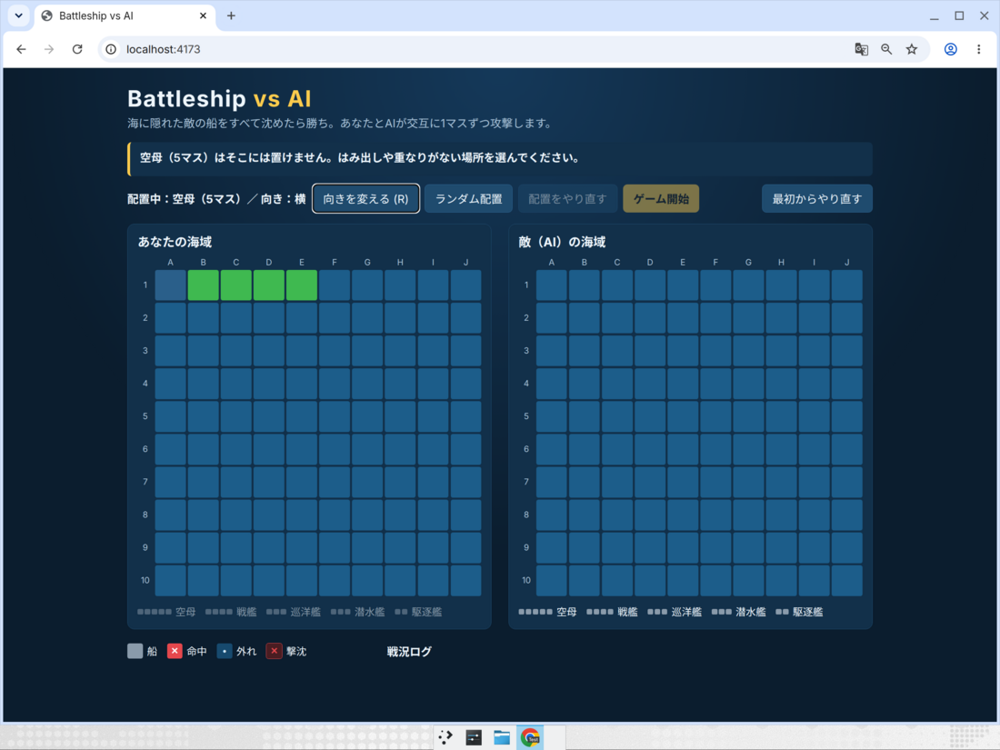
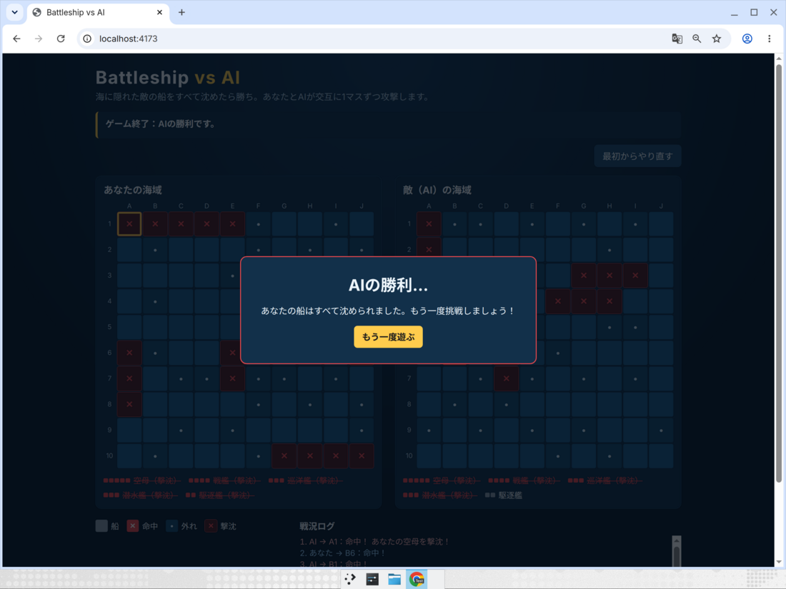
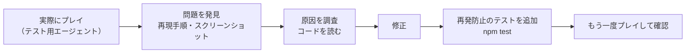

# バグレポート：発見したバグと修正内容

ゲーム完成後、ブラウザで実際に何度もプレイして動作を確認しました（Devin のテスト用エージェントが画面を操作）。
このページでは、見つかった問題・原因・修正方法をまとめます。

## 確認したこと（チェックリスト）

| チェック項目 | 結果 |
| --- | --- |
| ゲームは正常に開始できるか（5隻置くまで開始ボタンは押せない） | OK |
| 船を正しく配置できるか（回転・はみ出し/重なりの拒否・やり直し・ランダム配置） | OK（表示の不具合1件 → **バグ1**） |
| AIは正常に攻撃するか（プレイヤーの攻撃の約0.7秒後に自動で攻撃） | OK |
| AIが同じ場所を何度も攻撃しないか（1ゲーム45発がすべて異なる座標） | OK |
| 命中・失敗が正しく判定されるか（✕/•、メッセージ、ログ、撃沈表示） | OK |
| すべての船が沈んだときにゲームが終了するか（勝利・敗北の両方） | OK（終了画面の不具合1件 → **バグ2**） |
| 再スタート機能が正常に動くか（対戦中・AIの攻撃待ち中・終了後） | OK |
| AIの番に連打しても二重攻撃にならないか / 攻撃済みマスを押しても無視されるか | OK |
| スマホ幅（400px）でも遊べるか | OK |

## 見つかったバグ

### バグ1：配置プレビューで、マウスを置いたマスだけ色が変わらない（重要度：低）

**症状**
船を置く前、マウスを乗せると「置ける場所＝緑」「置けない場所＝オレンジ」でプレビューされます。
ところが **マウス直下の1マスだけ青いまま** で、5マスの空母が4マスに見えていました。



**原因**
CSS（見た目のルール）の優先順位の問題です。すべてのボタンに付けていた
「マウスを乗せたら少し明るい青にする」というルール `button:hover:not(:disabled)` が、
プレビュー色のルール `.cell.preview-ok` より **強い（詳細度が高い）** ため、マウス直下のマスだけ青で上書きされていました。

**修正**
汎用のホバー色をマス目には適用しないようにしました（`src/style.css`）。

```diff
- button:hover:not(:disabled) { background: #2a5f8a; }
+ button:not(.cell):hover:not(:disabled) { background: #2a5f8a; }
```

### バグ2：ゲーム終了画面が盤面を覆い、閉じられない（重要度：中）

**症状**
負けたときは、どこに敵の船が残っていたかを盤面に表示する仕組みになっています。
しかし結果画面（「AIの勝利…」）が盤面の上に重なり、閉じるボタンもないため、**残っていた敵の船（例：B6〜B7 の駆逐艦）が見えません**。
「もう一度遊ぶ」を押すと盤面がリセットされるので、最後の状況を確認する方法がありませんでした。



**原因**
結果画面を「ゲームが終わったら必ず表示する」作りにしていて、利用者が閉じる手段を用意していなかったためです。

**修正**（`src/ui/app.ts`）
- 結果画面に **「盤面を確認する」ボタン** を追加。押すと結果画面が閉じ、最終盤面（公開された敵の船を含む）を確認できます。
- 閉じた後も上部のメッセージに勝敗を表示し、「最初からやり直す」ボタンで次のゲームを始められます。
- 再スタート時には「閉じた」状態もリセットします。

```ts
let resultDismissed = false;               // 結果画面を閉じたかどうか
els.viewBoards.addEventListener('click', () => { resultDismissed = true; render(); });
els.result.hidden = !over || resultDismissed;
```

**再発防止のテスト**（`tests/app.test.ts`）
「敗北後は結果画面を閉じて、公開された敵の残りの船を確認できる」を追加しました。
AIに負けるまでプレイ → 「盤面を確認する」→ 敵の船のマスがすべて表示されていること、再スタートできることを自動で確認します。

## 開発中に見つけた環境まわりの問題（ゲームのバグではないもの）

| 問題 | 原因 | 対応 |
| --- | --- | --- |
| 最初に入れたテストツール（Vitest 3）に既知の脆弱性があった | 古いバージョン | `npm audit` で検出し、修正済みの Vitest 4.1.12 に更新（脆弱性 0 件） |
| `npm install` が `Cannot read properties of null (reading 'edgesOut')` で失敗 | npm 10.8.3 の不具合 | npm 11 に更新して解決 |
| テストが、凡例（説明用のマス）まで「攻撃済みマス」として数えて失敗 | テストの検索条件が広すぎた | 盤面のボタン（`button.cell`）だけを数えるよう修正 |

## 進め方（Devin を使ったバグ修正の流れ）


