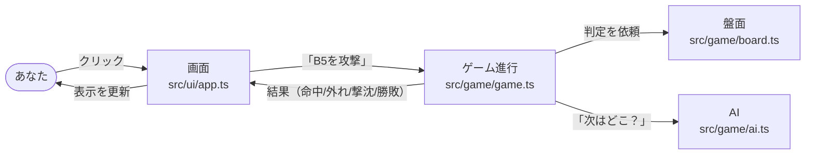
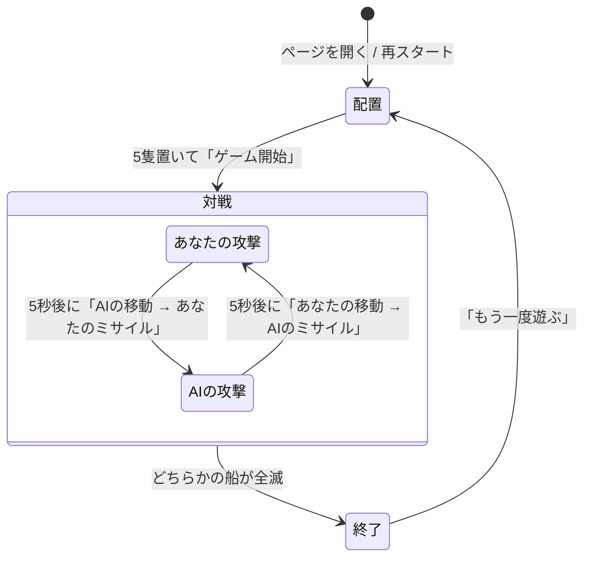
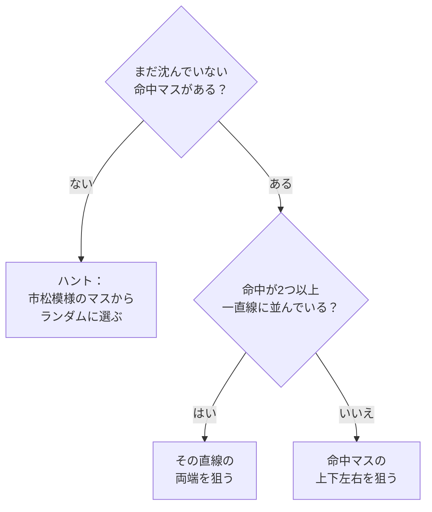
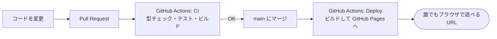

# しくみの解説（初心者向け）

このページでは、Battleship vs AI がどう動いているのかを、プログラミング初心者の方にもわかるように説明します。

## 1. 全体像：3つの部品

ゲームは大きく **「ルール」「AI」「画面」** の3つの部品でできています。



| 部品 | ファイル | たとえるなら | 役割 |
| --- | --- | --- | --- |
| 盤面 | `src/game/board.ts` | 将棋盤と駒 | 船を置く・攻撃を受けて「命中/外れ/撃沈」を判定する |
| AI | `src/game/ai.ts` | 対戦相手の頭脳 | 次にどのマスを攻撃するかを考える |
| ゲーム進行 | `src/game/game.ts` | 審判 | 誰の番か、ゲームが終わったか、勝者は誰かを管理する |
| 画面 | `src/ui/app.ts` | テレビ画面とリモコン | クリックを受け取り、結果を色や文字で表示する |

ポイントは **「ルール」と「画面」を分けている** ことです。ルール部分は画面のことを何も知らないので、
ブラウザがなくても自動テストで正しさを確かめられます。

## 2. ゲームの流れ



1. **配置**：空母(5)・戦艦(4)・巡洋艦(3)・潜水艦(3)・駆逐艦(2) を順番に置きます。`R` キーで縦横を切り替え。
   置けない場所（はみ出す・重なる）はオレンジ色、置ける場所は緑色でプレビューされます。
2. **対戦**：攻守は1ターンごとに交代します。毎ターン5秒のシンキングタイムに、攻撃側は狙うマスを、守り側は（動かすなら）船1隻の移動先を決めます。
   時間切れになると、先に守り側の船が動き、そのあと攻撃側のミサイルが発射されます。攻撃側が狙いを決めなかったときは、そのターンは攻撃なしです。
3. **終了**：相手の船を先に全部沈めた方の勝ち。結果画面から再スタートできます。

## 3. 盤面のしくみ（`board.ts`）

盤面は 10×10 のマス目で、プログラムの中では **2つの表（2次元配列）** で覚えています。

- `shipAt[行][列]` … そのマスにどの船があるか（なければ `null`）
- `shots[行][列]` … そのマスが攻撃済みか（`'hit'` 命中 / `'miss'` 外れ / `null` 未攻撃）

攻撃（`receiveAttack`）の判定はとてもシンプルです。

```
もし 盤面の外 なら → エラー
もし 攻撃済み なら → エラー（同じマスは2回攻撃できない）
もし 船がない なら → 「外れ」
そうでなければ     → その船の命中数を +1
                     命中数 = 船の長さ なら「撃沈」、それ以外は「命中」
```

全ての船が「撃沈」になったら、その盤面の持ち主の負けです（`allShipsSunk`）。

### 船の移動（`moveRange` / `canMoveBy` / `moveBy`）

守り側は、1ターンに1隻だけ船を動かせます。動ける量は「船の長さ − 被弾数」を N として、船の中心から **N×N の範囲** です（`moveRange`）。

| 船の状態 | 動ける範囲 |
| --- | --- |
| 無傷の空母（N=5） | 上下左右に最大2マス（5×5） |
| 1回被弾した空母（N=4） | 上と左に最大1マス、下と右に最大2マス（4×4。偶数のときは右・下が1マス多い） |
| 残り1マス以下（N≤1） | 動けない |

| ルール | 理由 |
| --- | --- |
| ほかの船・攻撃済みのマスは飛び越えられる | 移動は「ワープ」なので、途中のマスは関係ない |
| ほかの船と重なる場所・盤面の外には止まれない | 配置のときと同じルール |
| 命中マークは船と一緒に動く | 命中の記録は船の各部分（`ship.hits`）が持っているから |
| 船が止まったマスの「外れ」の印は消える | そこにはもう「何もない海」ではないので、もう一度攻撃できるようにする |

盤面は「外れ」の印だけを海の表（`misses`）に、命中の印は船の部分ごとに持っています。`shotAt(マス)` はこの2つを見て「命中・外れ・まだ」を答えます。

### ターンの進み方（`game.ts`）

| メソッド | 役割 |
| --- | --- |
| `planTarget(マス)` | あなたの攻撃ターン：狙うマスを決める（`null` で取り消し） |
| `planMove({ ship, offset })` | あなたの守りターン：動かす船と移動量を決める（`null` で取り消し） |
| `resolveRound()` | 時間切れ：守り側の移動 → 攻撃 の順に実行し、攻守を交代する |

AIはターンの始めに、攻撃なら狙うマス、守りなら動かす船を先に決めておきます。あなたが何を選んだかを見てからずるく決めることはありません。
狙ったマスに、被弾済みの船の部分が移動してきた場合は「効果なし」になります。

## 4. AIの考え方（`ai.ts`）

AIは人間がよく使う **「ハント＆ターゲット」** という作戦で戦います。



- **ハント（探す）**：一番短い船でも2マスあるので、市松模様（チェック柄）の半分のマスだけ探せば必ずどこかに当たります。
- **ターゲット（仕留める）**：当たったら周りを狙い、2つ当たって向きがわかったらその線に沿って攻撃します。
- **撃沈したら**：その船のマスは「もう狙わなくていい」と覚え、ハントに戻ります。
- **印のあるマスは撃たない**：船は動くので、AIは毎ターンの始めに `observe(盤面)` であなたの盤面の印（外れ・命中・撃沈）を読み直し、
  印のないマスだけを候補にします。命中マークは船と一緒に動くので、逃げた船も追いかけられます。

### AIの強さ（弱い・普通・強い）

船を配置している間だけ、画面上部の「AIの強さ」ボタンで3段階から選べます（ゲーム開始後は変えられません。「最初からやり直す」では選んだ強さがそのまま残ります）。
上で説明した「ハント＆ターゲット」は **普通** の作戦です。

| 強さ | 攻撃のしかた | 回避する確率 | 全艦撃沈までの目安 |
| --- | --- | --- | --- |
| 弱い | まだ撃っていないマスから完全にランダム。当たっても隣を狙うとは限らない | 0%（回避しない） | 約95手 |
| 普通 | ハント＆ターゲット | 50% | 約52手 |
| 強い | 確率マップ（下の説明） | 80% | 約44手 |

**強いAIの「確率マップ」**：まだ沈んでいない船について、「この船が置ける場所」を盤面の全パターン数えます（外れたマスや沈んだ船の上には置けないので除外）。
たくさんのパターンが重なるマスほど船がいそうなので、そこを撃ちます。命中したマスがあるときは、そのマスを通るパターンだけを数えるので、残りの部分を素早く見つけます。
目安の手数は、`tests/ai.test.ts` のように船を動かさずに何試合も対戦させたときの平均です。

強さは `Game` を作るときに渡し（`new Game(random, 'hard')`）、`AiPlayer` が `difficulty` に合わせて作戦を切り替えます。
回避する確率は `EVADE_CHANCES` にまとまっています。

### AIの移動（`chooseEvasion`）

AIが守りのターンには、**被弾している船** と **あなたの前回の弾のすぐ近くにいる船** を「狙われそうな船」と考えます。
（強さ「普通」なら）50%の確率で、その中の1隻を、前回の弾からいちばん遠くなる場所へ動かします。どの船が動いたかは表示されません。

## 5. 画面のしくみ（`app.ts` / `sprites.ts`）

画面は「**状態（データ）が変わったら、全部描き直す**」という単純なルールで作っています（`render` 関数）。

1. ターンが始まると `startRound()` が5秒のタイマー（`setTimeout`）と、残り秒数の表示（シンキングタイムのバー）を動かす
2. クリックされたマスで `game.planTarget` / `game.planMove` を呼び、狙い（枠）や移動先（半透明の船）を `render()` で描く
3. 時間切れで `endRound()` が `game.resolveRound()` を呼び、ミサイルを飛ばす
4. ミサイルが着弾したら結果を表示し、次のターンの `startRound()` へ

画面上の盤面は1つで、各行に「自陣10マス → 中央線 → 敵陣10マス」の順でボタンを並べています（`buildGrid`）。
ルール上は今まで通り2つの盤面（`playerBoard` と `aiBoard`）があり、ボタンの `data-owner`（`player` / `ai`）でどちらの盤面のマスかを区別しています。

守りのターンに自分の船をクリックすると「選択中」になり、動ける場所が光ります。光ったマスをクリックすると船の中心がそこへ、矢印ボタン・矢印キーでは1マスずつ移動先が動きます。

### ミサイルの弾道（`missile.ts`）

攻撃すると、撃った側（あなたは左端、AIは右端）から狙ったマスへ **ミサイルが山なりに飛んでいきます**。

1. `flightPath` が「スタート地点 → 高い所を通る中間点 → 狙ったマス」を結ぶなめらかな曲線（2次ベジェ曲線）上の点を計算します。
   各点では「ミサイルがどちらを向いているか（角度）」も計算するので、先端が常に進む方向を向きます。
2. `launchMissile` がミサイルの絵を盤面の上に重ね、ブラウザのアニメーション機能（`element.animate`）でその点を順番にたどらせます。
3. 飛んでいる間（約0.8秒）、ミサイルは光の尾を引き、狙われたマスは水色の枠が光り（`incoming`）、命中/外れの絵は隠れます。着弾した瞬間にミサイルを消し、爆発や水しぶきを表示します。
   上のメッセージ欄は飛んでいる間「〇〇へミサイル発射！」になり、命中/外れのメッセージ・戦況ログ・効果音は **着弾した瞬間** に出ます（`fireMissile` に渡した `onImpact` の中で処理）。

ルール上の判定（`game.resolveRound`）は時間切れの瞬間に終わっていて、ミサイルは **見た目だけの演出** です。
なので演出があってもなくても勝敗は変わりません。OSの「視差効果を減らす／アニメーションを減らす」設定
（`prefers-reduced-motion`）がオンのときは、ミサイルを飛ばさずにすぐ結果を表示します。

### 動く海（`sea.css`）

盤面の自陣・敵陣それぞれの下に、海を描くための板（`.sea`）を1枚ずつ敷いています（`buildGrid` が作成）。
マスのボタンは半透明なので、その下で動く海が透けて見えます。

- **うねり**：ブラウザに作らせた「雲のような模様」（SVGの `feTurbulence`）を横長に引き伸ばし、波の山と谷に見立てています。
- **きらめき**：同じような模様に光を当てた絵（`feSpecularLighting`）を重ね、うねりとは別の向きに流しつつ明るさをゆっくり変えています。
- 2枚の模様は「端と端がつながる絵」（タイル）なので、ちょうど1枚分ずらすと元の位置に戻り、継ぎ目なく動き続けます。

動かしているのは「位置（`transform`）」と「透明度（`opacity`）」だけで、JavaScriptは使いません。
ブラウザが画面の描き直しをせずに動かせるので、動作が重くなりません。
「アニメーションを減らす」設定（`prefers-reduced-motion`）がオンのときは、海は止まった絵になります。

### 船のイラストのしくみ（`sprites.ts`）

船は、上から見た最新の軍艦（ステルス艦）をイメージして、**SVG（線や図形で描く画像）** で描いています。
拡大しても、ぼやけません。

- 船体：先がとがった細長い形（`hullPoints`）。上半分を明るく、下半分を暗く塗り分けて、金属の光沢を出しています（`metal`）。
- 艦橋（`deckhouse`）、主砲（`gun`）、ミサイル発射口（`launchCells`）、空母の飛行甲板と艦載機、潜水艦の司令塔を部品として組み合わせます。
- 水色の発光ラインは自分の船、赤は敵の船です。撃沈した船は焦げた色（`wreck`）になります。

どの船も「長さ×1マス」の横長の絵として、右向きに描きます。
縦向きの船や敵の船は、`orientTransform` で絵を回転・反転させます。
そのあと、船が乗っている各マスに「自分の部分」だけを切り抜いて表示します（SVGの `viewBox` で、表示する範囲を1マス分に絞ります）。

### 艦隊パネルと通算成績（`renderFleet` / `record.ts`）

画面の右側に、敵艦隊・自艦隊の「残り〇/5隻」と、船ごとの状態を表示します。

- 状態の札：`健在`（無傷）、`被弾`（当たったが沈んでいない）、`撃沈`、`未配置`（配置中のみ）
- 船の絵の上に、当たったマスの位置を赤い光で表示します。

ゲームが終わると、`VICTORY`（勝ち）または `DEFEAT`（負け）の画面に、攻撃回数・命中率・残った自分の船の数を表示します。
勝ち負けは `record.ts` がブラウザの保存領域（`localStorage`、キーは `battleship-record`）に記録します。
ページを閉じても残り、右上に「〇勝〇敗・勝率〇%」と表示します。
1試合で記録するのは1回だけです（「盤面を確認する」で結果画面を閉じても、二重に数えません）。

## 6. テストと公開



- `npm test` で `tests/` の自動テスト（ルール・AI・画面）が動きます。
- Pull Request を作ると CI が自動でテストし、壊れていないかを確認します。
- `main` に入ると自動でビルドされ、GitHub Pages で公開されます。サーバーは不要で、AIもブラウザの中で動いています。
