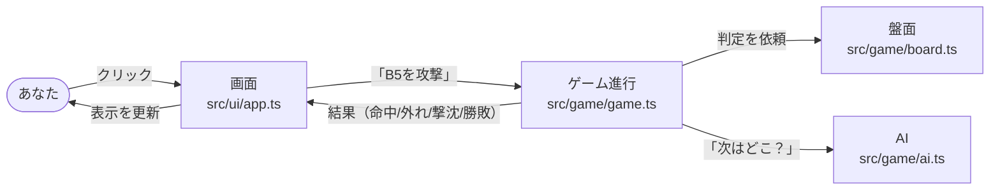
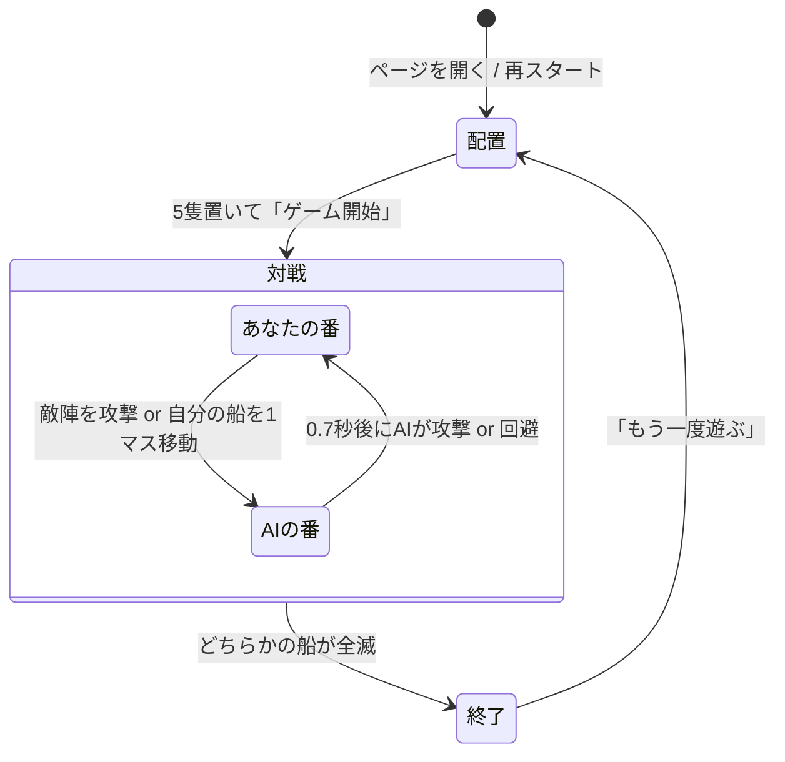
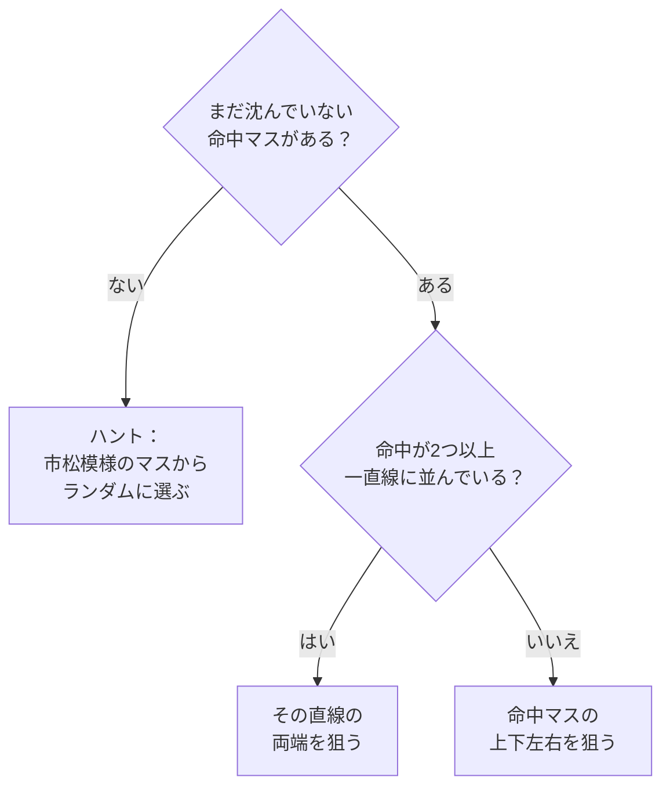
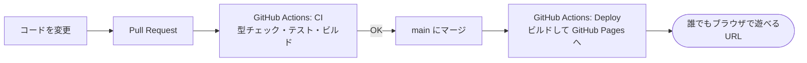

# しくみの解説（初心者向け）

このページでは、Battleship vs AI がどう動いているのかを、プログラミング初心者の方にもわかるように説明します。

## 1. 全体像：3つの部品

ゲームは大きく **「ルール」「AI」「画面」** の3つの部品でできています。



| 部品 | ファイル | たとえるなら | 役割 |
| --- | --- | --- | --- |
| 盤面 | `src/game/board.ts` | 将棋盤と駒 | 船を置く・攻撃を受けて「命中/外れ/撃沈」を判定する |
| AI | `src/game/ai.ts` | 対戦相手の頭脳 | 次にどのマスを攻撃するかを考える |
| ゲーム進行 | `src/game/game.ts` | 審判 | 誰の番か、ゲームが終わったか、勝者は誰かを管理する |
| 画面 | `src/ui/app.ts` | テレビ画面とリモコン | クリックを受け取り、結果を色や文字で表示する |

ポイントは **「ルール」と「画面」を分けている** ことです。ルール部分は画面のことを何も知らないので、
ブラウザがなくても自動テストで正しさを確かめられます。

## 2. ゲームの流れ



1. **配置**：空母(5)・戦艦(4)・巡洋艦(3)・潜水艦(3)・駆逐艦(2) を順番に置きます。`R` キーで縦横を切り替え。
   置けない場所（はみ出す・重なる）はオレンジ色、置ける場所は緑色でプレビューされます。
2. **対戦**：自分の番に「敵陣を1マス攻撃」か「無傷の船を1マス移動」のどちらかを行い、AIの番と交互に繰り返します。
3. **終了**：相手の船を先に全部沈めた方の勝ち。結果画面から再スタートできます。

## 3. 盤面のしくみ（`board.ts`）

盤面は 10×10 のマス目で、プログラムの中では **2つの表（2次元配列）** で覚えています。

- `shipAt[行][列]` … そのマスにどの船があるか（なければ `null`）
- `shots[行][列]` … そのマスが攻撃済みか（`'hit'` 命中 / `'miss'` 外れ / `null` 未攻撃）

攻撃（`receiveAttack`）の判定はとてもシンプルです。

```
もし 盤面の外 なら → エラー
もし 攻撃済み なら → エラー（同じマスは2回攻撃できない）
もし 船がない なら → 「外れ」
そうでなければ     → その船の命中数を +1
                     命中数 = 船の長さ なら「撃沈」、それ以外は「命中」
```

全ての船が「撃沈」になったら、その盤面の持ち主の負けです（`allShipsSunk`）。

### 船の移動（`canMoveShip` / `moveShip`）

対戦中は、攻撃の代わりに船を上下左右に1マス動かせます。ゲームが破綻しないよう、次のルールを守る場合だけ動かせます。

| ルール | 理由 |
| --- | --- |
| まだ一度も被弾していない船だけ | 命中の記録（✕）と船の位置がずれないようにするため |
| 盤面の外・ほかの船の上には動けない | 配置のときと同じルール |
| すでに撃たれたマスには動けない | 「同じマスは二度攻撃しない」というルールを守るため（外れのマスはずっと外れ） |

移動すると `shipAt` の表から古い位置を消し、新しい位置に書き直します。`shots`（攻撃の記録）は動かしません。

## 4. AIの考え方（`ai.ts`）

AIは人間がよく使う **「ハント＆ターゲット」** という作戦で戦います。



- **ハント（探す）**：一番短い船でも2マスあるので、市松模様（チェック柄）の半分のマスだけ探せば必ずどこかに当たります。
- **ターゲット（仕留める）**：当たったら周りを狙い、2つ当たって向きがわかったらその線に沿って攻撃します。
- **撃沈したら**：その船のマスは「もう狙わなくていい」と覚え、ハントに戻ります。
- **同じマスは撃たない**：AIは自分が撃ったマスを全部 `tried` に記録しており、候補から必ず除外します。
  船は撃たれたマスに移動できないので、船が動いてもこの記録は正しいままです。

### AIの回避（`chooseEvasion`）

あなたの攻撃が **AIの無傷の船のすぐ隣で外れた** とき、AIは50%の確率で攻撃をやめ、その船を弾から離れる方向へ1マス動かします。
「惜しい！」と思って次に隣を撃っても、もうそこにはいないかもしれません。どの船が動いたかは表示されません。

## 5. 画面のしくみ（`app.ts` / `sprites.ts`）

画面は「**状態（データ）が変わったら、全部描き直す**」という単純なルールで作っています（`render` 関数）。

1. クリックされたマスの座標を調べる
2. `game.playerAttack(座標)` でルールに判定してもらう
3. `render()` で盤面の色・メッセージ・ログを描き直す
4. `setTimeout` で 0.7秒後に `game.aiTakeTurn()`（攻撃か回避）を呼び、また `render()`

画面上の盤面は1つで、各行に「自陣10マス → 中央線 → 敵陣10マス」の順でボタンを並べています（`buildGrid`）。
ルール上は今まで通り2つの盤面（`playerBoard` と `aiBoard`）があり、ボタンの `data-owner`（`player` / `ai`）でどちらの盤面のマスかを区別しています。

自分の船をクリックすると「選択中」になり、矢印ボタン・矢印キーで `game.playerMove(船, 向き)` を呼びます。

### ドット絵のしくみ（`sprites.ts`）

船の絵は、1マス＝8×8ドットとして **文字で描いて** います。文字1つが1ドットの色です（`.` は透明）。

```text
....WW..........      W = 白, B = 青, L/G = 灰色
....WBW.........      Y/O = エンジンの炎（黄・オレンジ）
..WWWWWWWW......      C = 水色
YOWLLLLLLLLWWW..
YOWGGGGGCCGLLLWW      ← 駆逐艦（2マス = 16×8ドット）
..WWWWWWWW......
....WBW.........
....WW..........
```

この文字の絵をプログラムでSVG画像に変換し、船が乗っている各マスに「自分の部分」だけを切り抜いて表示します。
縦向きの船は絵を90度回転させ、敵の船は左右反転して左向きにします。色の組み合わせ（パレット）を差し替えるだけで、
自軍（白・青）、敵（赤・オレンジ）、撃沈（暗い灰色）の3種類を作り分けています。

AIの番の間は敵陣のボタンが押せなくなる（`disabled`）ので、連打しても二重攻撃になりません。
再スタート時は待機中のAIのタイマーも必ず止めます（止め忘れると新しいゲームにAIの攻撃が紛れ込むバグになります）。

## 6. テストと公開



- `npm test` で `tests/` の自動テスト（ルール・AI・画面）が動きます。
- Pull Request を作ると CI が自動でテストし、壊れていないかを確認します。
- `main` に入ると自動でビルドされ、GitHub Pages で公開されます。サーバーは不要で、AIもブラウザの中で動いています。
